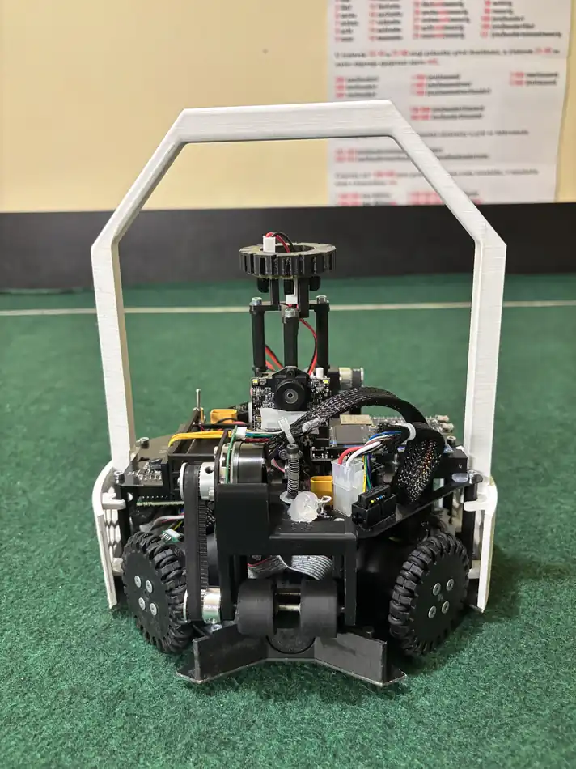
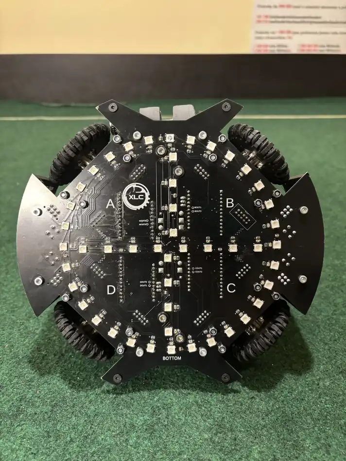
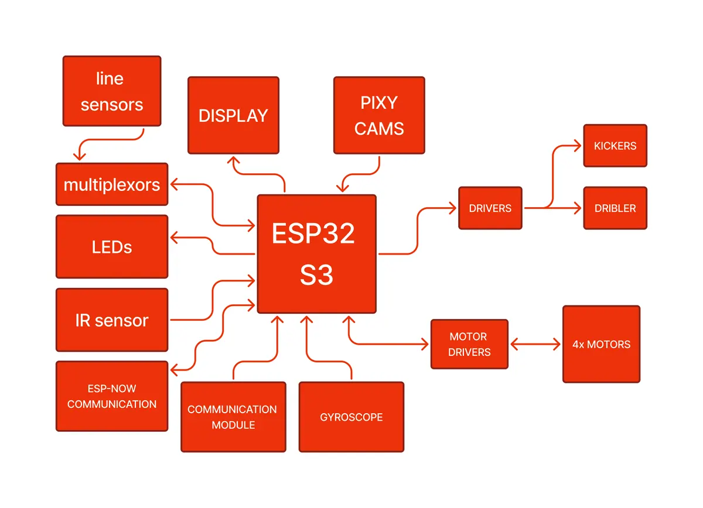
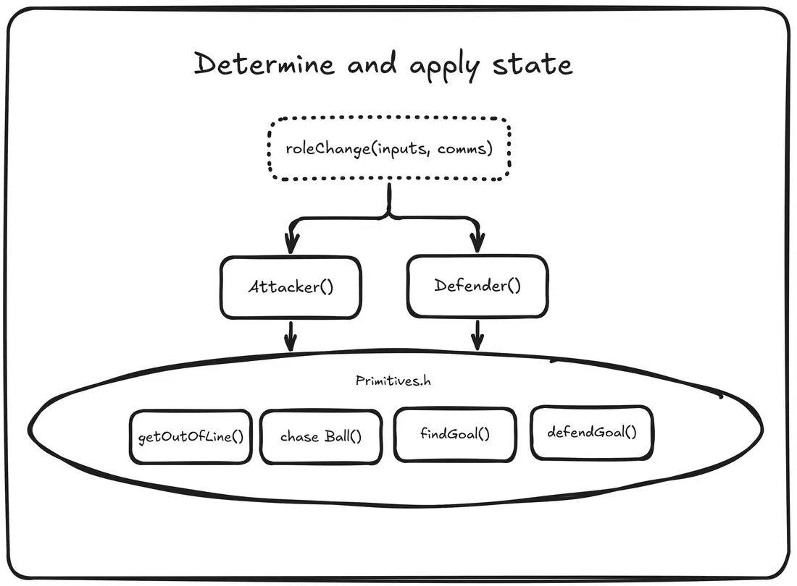

# RoboCupJunior Soccer 2026 — Incheon, Korea

We are **XLC – WYLDFYRE**, a team of four students from Slovakia. For the **RoboCupJunior Soccer Infrared**
world final in Incheon (2–6 July 2026) we built two identical autonomous soccer robots, each running on one
**ESP32-S3**. We qualified 2nd at the 2026 Slovak championship and finished **11th of 24** in Incheon, with
three wins, one draw and three losses.

📝 We wrote about the robot in more detail on the Espressif Developer Portal:
[Building a RoboCup Junior Soccer Robot](https://developer.espressif.com/blog/2026/09/robocup-junior-soccer-robot/).

<p align="center">
  
  
</p>

## The robot

The rules allow 1.5 kg, and ours weighed 1.4 kg at 22 cm across. Almost every design decision followed
from that limit. We didn't build a frame. Instead, the robot is **two custom four-layer PCBs**, and those
boards are the structure. The wheels pass through cut-outs in the bottom board.

| Part | What we used |
|---|---|
| MCU | ESP32-S3-DevKitC-1 (N8R8, with PSRAM disabled) |
| Drive | 4× Maxon motors with **Maxon ESCON 24/2** drivers, home-made 3D-printed omni wheels |
| Dribbler | Maxon motor and a rubber roller, ball detection with a **micro-switch from a computer mouse** |
| Kicker | Solenoid at 48 V through a PM8834 gate driver |
| Line | 48 phototransistors and 48 WS2812B RGB LEDs, 3× CD74HC4067 multiplexer |
| Ball | MRMS IR Ball Finder 3 (I²C) |
| Heading | BNO055 |
| Goals | 2× Pixy2, front and rear |
| UI | SSD1306 128×64 OLED with menus, 2 buttons, 4 status LEDs |
| Power | 4S Li-HV, 1100 mAh, about 20 minutes of play |

<p align="center">
  
</p>

We designed the omni wheels in Fusion 360, 3D printed them, and assembled them with wire and silicone
rings. When the dribbler roller lifts to take the ball, it opens the mouse switch, which is wired straight
to a GPIO. It is the simplest sensor on the robot, and it never failed.

## Why the ESP32-S3

Our earlier robots ran on an Arduino Mega, and its memory was full almost all the time. We ended up writing
simpler code than the robot needed, because the better version didn't fit. Floating-point maths was also
too slow at the speeds our robot moves. The line-angle calculation alone runs `sin` and `cos` across 32
sensors at 333 Hz. The ESP32-S3 has two 32-bit cores at 240 MHz with a hardware FPU, which let us write
the control law we wanted instead of the one that fit.

**ESP-NOW** is the reason we would pick the chip again, because our whole two-role strategy depends on it.

## Every pin on the board

The robot needs 33 GPIOs. The DevKitC-1 only has that many if you also use the pins the documentation
warns about, so we did:

- **All four strapping pins became our multiplexer address bus.** Strapping pins only matter for a moment
  at reset, and the mux address inputs are high-impedance. In a whole season it never caused a boot problem.
- **Disabling PSRAM gave us GPIO35–37** (`board_build.psram = none`).
- **The native USB D−/D+ pins read our two buttons,** so we flashed the robots over the UART bridge.
- **We never used JTAG.** We debugged on the OLED instead, which shows live values while the robot drives untethered.

| GPIO | Function | Note |
|---|---|---|
| 0 / 45 / 46 / 3 | Line mux address bits 0–3 | all four **strapping pins** |
| 4 / 5 / 6 | Line mux analog returns | ADC1_CH3–5 |
| 8 / 9 | I²C SDA / SCL | 400 kHz |
| 2 / 10 / 7 / 21 | Dribbler dir, PWM; front, rear kicker | |
| 41/42, 47/48, 13/14, 11/12 | Motor A–D PWM / dir | 41/42 are JTAG pins |
| 15–18 / 38 | Motor speed feedback / shared enable | |
| 19 / 20 | Button − / + | native **USB D− / D+** |
| 35 / 36 / 37 | Referee module, two WS2812B strings | **PSRAM bank** |
| 39 / 40 | Dribbler switch rear / front | JTAG pins |
| 43 / 44 | free | UART0, our only console |

## Line sensing

The ESP32-S3 has ten usable ADC1 channels, and we needed 48 readings. Three 16-channel multiplexers share
one 4-bit address bus, so a single loop of 16 steps reads three sensors per step. The whole array is read
at 333 Hz.

Each phototransistor sits next to an RGB LED that lights the floor. Red would have given the best contrast,
but the rules don't allow it, so we used violet and pink. The readings were clean enough that one threshold
(250 out of 4095) worked for all 48 sensors, with no per-sensor calibration.

The sensors form two arrays:

- **32 sensors form a ring** that gives the *direction* of the line. Each triggered sensor adds a unit vector
  at its angle, and `atan2` gives the result.
- **16 sensors form four arms** that give *how far* the robot is over the line. Comparing the front and rear
  arms gives `depth_Y`, which made our defender possible.

## Firmware

The firmware is a PlatformIO project in [`Code/Rcj26_V0`](Code/Rcj26_V0). Everything runs from `loop()`,
which does the same four steps every cycle:

```
inputs_update()  →  Logic::determineMode()  →  Logic::applyMode()  →  outputs_update()
```

We didn't create any FreeRTOS tasks of our own. Instead, each input has its own `millis()` interval:
1 kHz for the gyro, 333 Hz for the line, 200 Hz for the ball and 5 Hz for ESP-NOW. The cameras are the most
expensive read on the I²C bus, so we poll them at 10 Hz when holding the ball or defending and 1 Hz otherwise.

We split the code into a hardware layer and a behaviour layer:

```
include/ & src/
├── world.*                 shared state: IN:: (inputs), ST:: (state), OUT:: (outputs)
├── robot_types.h           state structs and enums
├── Low/                    hardware layer
│   ├── config_hw.h         pins, I²C addresses, sensor constants, ESP-NOW peers
│   ├── Inputs/             ballIR, line, gyro, pixy, motionSense, communication, ps5_controller, buttons
│   └── Outputs/            motor, kicker + dribbler, LEDs, display
└── High/                   behaviour layer
    ├── config_app.h        PID gains and defaults
    ├── Services/           mode state machine, motion accumulator, wheel lookup table, debug flags
    ├── Modes/              off (menu), soccer, controller, kicker test, LED calibration
    └── Roles/              attacker, defender, controller
        └── Primitives/     chase ball, find goal, defend goal, avoid line
```

### Motion without trigonometry

We solved the wheel trigonometry offline for every whole degree. The result is a 361-row table of wheel
weights that takes 5.8 kB of flash. On top of the table, no behaviour drives the motors directly. Each
behaviour *adds* a weighted vector to a shared accumulator, and the motors get whatever has accumulated by
the end of the cycle.

This way, behaviours blend instead of fighting. When the attacker chases the ball near the line, line
avoidance adds a vector away from the boundary, and that vector gets stronger the further over the line
the robot is. We never had to write arbitration logic. The accumulator is cleared after every cycle, so a
behaviour that stops asking for motion stops the robot.

The ESCON drivers treat 0 % and 100 % duty cycle as "no valid signal". We mapped every command into a
9–89 % window, and we write a true 0 % on purpose when the motors are disabled, so that the drivers shut
down on their own. The driver configurations we used are in [`Escon/`](Escon).

### The defender

Over the week in Incheon, several teams asked us how our defender worked. It uses two absolute references
that don't drift. **The rear Pixy2 gives the goal**, as an angle and an apparent size. **The line array gives
the depth** through `depth_Y`.

It never turns around. It holds one heading for the whole match and only strafes. The strafe speed is
`sin(ball angle) × proximity`, clamped to ±0.25. The sine is the ball's projection onto the goal line:

- A ball straight ahead gives zero, so the defender stays put.
- A ball at 90° gives full speed.
- A ball behind the robot gives very little.

A proportional term on `depth_Y` keeps the robot on the goal line. The defender also refuses to start until
it knows where it is: until it has seen our goal in the last 500 ms *and* its line sensors are on the line.

<p align="center">
  
</p>

### Two robots, one strategy

The hardware is identical, so the attacker and defender roles are only values in a struct. Both robots run
the same firmware, and a menu setting picks which ESP-NOW peer each one talks to. At 5 Hz, they exchange their
mode, role, ball angle and distance, line and goal state, heading, and a single command code for swapping
roles. Neither robot tells the other where to drive, so a dropped packet is never a problem.

Roles swap when both buttons are held, or when the defender wins the ball. In that case it becomes the
attacker, then switches back two seconds after losing the ball. We added a minimum time before another
swap, because the first version flipped roles several times a second.

### PS5 controller

The ESP32-S3 has no Bluetooth Classic, so we paired a PS5 DualSense with a separate classic ESP32
([`Code/esp32dev_ps5`](Code/esp32dev_ps5)). That board forwards the controller state to the robot over UART
every 10 ms. We calibrated the robot by driving it by hand while watching live sensor values on the OLED.

## What broke

- **Cables.** In our first match, against Brazil, both robots stopped at the same moment because connectors
  had worked loose. We lost 7:11. The fix was glue.
- **The kicker gate driver.** The PM8834 datasheet allows merging its two outputs to drive one load, so we
  merged them. We kept destroying gate drivers, and several times the failure took the ESP32-S3 with it.
- **The attacker.** We built a defender that could compete with the best teams, but the attacker never got
  the same treatment. We could stop other teams from scoring, but we couldn't score reliably ourselves.

## What we would do differently

- **A better attacker**, built the same way as the defender: absolute references and a simple control law.
- **Our own ball-sensor fusion.** It is already in the code, compiled out behind `BALL_USE_RAW_DATA`, but it
  doesn't beat the filtering on the commercial module yet.
- **Two dribblers and two kickers.** The boards already have front and rear connectors for both, and the
  firmware already has `kickFront()` and `kickRear()`. We ran out of time.

## Team

**XLC – WYLDFYRE**: Martin Šuriak (hardware, 3D modelling), Ondrej Peter (electronics),
Jakub Bohunický (hardware, electronics), Diana Kunová (software). Our mentor was Samuel Peter.

Our team repository, with schematics, board layouts and the poster:
[XLC-WyldFyre/Robocup-Junior-2026](https://github.com/XLC-WyldFyre/Robocup-Junior-2026).

Released under the [MIT License](LICENSE).
